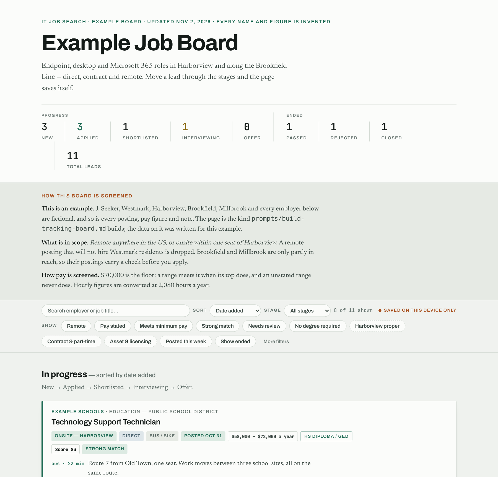
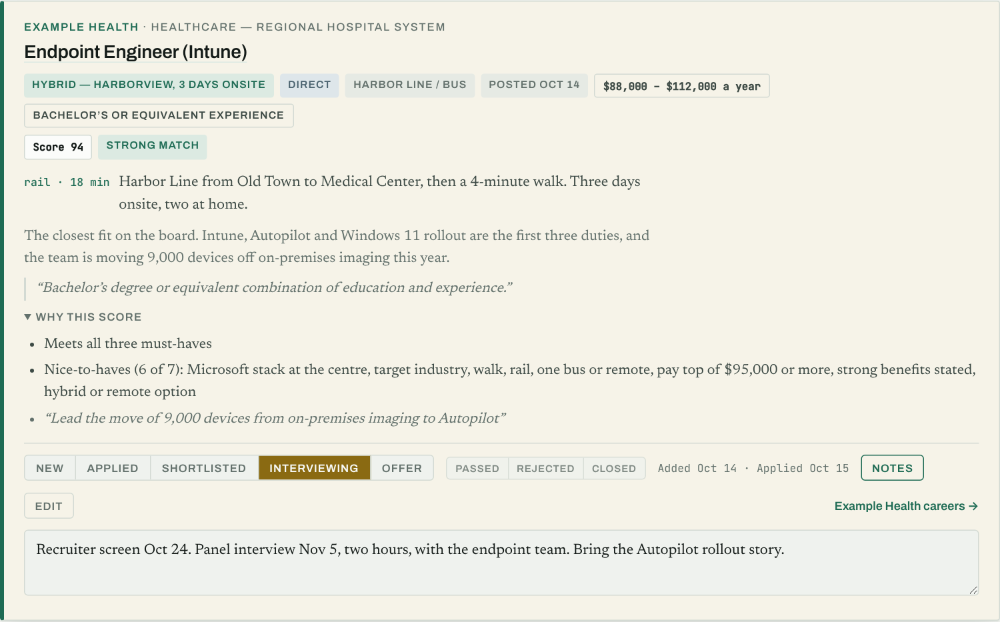

# JobSweep

A PowerShell job-board sweep. It polls applicant-tracking-system APIs across a
list of employers, screens the results against your own title and geography
rules, and writes a candidate list — so the reading you do each morning is a
dozen postings worth judging rather than four hundred worth skimming.

It is a screening tool, not a matching tool. **Every rule is designed to hand a
borderline posting to a human rather than bin it**, because the failure that
costs you a job is the one that looks like a quiet week.

## Why the filters are shaped the way they are

Every silent-screening bug this project has had looked identical from the
outside: *nothing was posted this week.* None of them threw an error.

- `\bmanager\b` in the exclude list killed **Software Asset Manager** — a
  target title — so `TitleProtect` now wins outright over `TitleExclude`.
- A bare `entra` matched **CENTRAl Kitchen**; a bare `iam` matches **Williams**.
  Stems that are also substrings are anchored with `\b`.
- A bare `licens` matched five clinical reqs — *Licensed Child, Youth & Family
  Therapist* — so it is anchored to the software sense.
- A bare state name in the include list passes that state's namesakes elsewhere
  (`washington` lets **Washington, DC** through), which is why a namesake is a
  *commute* exclusion rather than a country one.
- A malformed location field, the literal string `US-`, fell past every check
  to "location out of scope" and dropped the best lead of that week.

**A green exit code says the plumbing worked, not that the filter is right.**
That is what the test suite is for.

## Layout

| File | Ships | What it is |
|---|---|---|
| `Invoke-JobSweep.ps1` | ✅ | The collector. Providers, paging, retry, screening, output. |
| `JobSweep.targeting.psd1` | ✅ | **What counts as a job worth looking at.** Title rules only — this describes a search, not a person. |
| `JobSweep.local.psd1` | ⛔ **gitignored** | **Where you will go and who you are watching.** Geography, commute boundary, remote rules, and the employer list. |
| `JobSweep.targeting.example.psd1` | ✅ | A simpler starting point if you are retargeting the sweep. |
| `JobSweep.local.example.psd1` | ✅ | A worked geography for a fictional state (Westmark) with placeholder employers. Copy it and replace every name. |
| `Find-JobSweepSources.ps1` | ✅ | The source scout. Turns careers URLs and company names into `Sources` entries you can paste. See [Finding new sources](#finding-new-sources). |
| `Test-JobSweepFilters.ps1` | ✅ | The regression suite. 375 cases, no network. |
| `Test-JobSweepLint.ps1` | ✅ | Lints every script with PSScriptAnalyzer, exactly as CI does. Fails on errors and warnings. |
| `PSScriptAnalyzerSettings.psd1` | ✅ | Lint rules for PSScriptAnalyzer: which rules are off and why. Read by the command line and the VS Code PowerShell extension. |
| `CLAUDE.md` | ✅ | Rules for Claude Code sessions in this repo. Personal ones go in a gitignored `CLAUDE.local.md`. |
| `prompts/build-tracking-board.md` | ✅ | A Claude prompt that turns your sweeps and your criteria into a job tracking board. |
| `docs/example-board.html` | ✅ | An example tracking board for a fictional job seeker in Westmark. Open it in a browser. Every name and figure is invented. |
| `docs/images/` | ✅ | Screenshots of the example board, used in this README. |

`JobSweep.local.psd1` is the file that must never be published. It is first in
`.gitignore` for that reason. Before making a repository public, read
`git status` and the full diff and confirm it is **absent from the commit**,
not merely present-and-ignored.

## Getting started

```powershell
git clone git@github.com:<you>/jobsweep.git
cd jobsweep

# 1. The suite runs green immediately, against the shipped example geography.
.\Test-JobSweepFilters.ps1

# 2. Make your own geography and employer list.
Copy-Item JobSweep.local.example.psd1 JobSweep.local.psd1
#    ...edit it: LocationInclude, CommuteExclude, real ATS tokens in Sources,
#    ClearanceScreen (will you take a job that needs a clearance you don't
#    hold?), and optionally OutputRoot.

# 3. Point the suite at your profile to see what your own rules do. Checks that
#    name the example's fictional towns are skipped and counted; assert your own
#    places in a Test-JobSweepProfile.ps1 beside your profile (also gitignored).
.\Test-JobSweepFilters.ps1 -ProfilePath @('.\JobSweep.targeting.psd1', '.\JobSweep.local.psd1')

# 4. Sweep.
.\Invoke-JobSweep.ps1
```

The collector defaults to the two real profile files beside it and **throws if
either is missing**, by design — a profile that fails to load leaves the title
list empty, matches nothing, and reports a normal-looking quiet day.

Output goes to `<OutputRoot>\Sweeps`. `OutputRoot` is, in order of precedence,
the `-OutputRoot` parameter, the `OutputRoot` key in your local profile
(`%USERPROFILE%`-style variables are expanded), or the folder the script lives
in, where `Sweeps\` is gitignored. Whichever applies must already exist: the
run stops rather than create a folder somewhere nobody looks.

## How screening works

**Titles**, in this precedence and the order matters:

1. `TitleProtect` — wins outright. Use it for titles your exclusions would
   otherwise eat.
2. `TitleExclude` — excludes the posting.
3. `TitleInclude` — a posting must match one of these to survive.

**Locations**: a posting reading as remote is screened against `LocationExclude`
and the `RemoteBlock` patterns, which catch the *"we cannot hire in your state"*
clause buried in an otherwise-remote listing. An onsite posting must match
`LocationInclude` and must not match `CommuteExclude`.

Two escape hatches handle geography a city rule cannot settle, and both **flag**
with `CHECK:` rather than deciding. `WorksiteCheck` covers a city that is only
partly in scope: a posting carries a city and never a street address, so when
half a city is reachable and half is not, the question travels with the posting
instead of the posting disappearing. `RegionCheck` covers a string that names no
city at all — *"Greater Metro Area"*, *"Bay Region"*. Left alone those either
match `LocationInclude` on a substring and pass unflagged, or match nothing and
are dropped; either way the screening is silently wrong, so they are flagged in
both directions.

**Clearances**: `ClearanceScreen` in your local profile answers one question:
will you take a job that needs an active Secret, Top Secret or TS/SCI clearance
you don't already hold? `'drop'` screens out postings that require one, `'check'`
(the default) keeps them with a `CHECK` note, and `'off'` turns the screen off.
A posting that offers a path to a clearance, such as *"ability to obtain"* or
*"must obtain within 90 days"*, or only prefers one, is always kept with a
`CHECK` note. "Secret" counts only beside the word clearance, so *"trade
secrets"* is not a hit.

## Tracking board (optional)

The sweep finds and screens postings; deciding which ones are worth an
application is a judgement call. [`prompts/build-tracking-board.md`](prompts/build-tracking-board.md)
is a prompt for Claude that makes that call against **your** criteria and turns
the result into a board you track applications on.

```powershell
# Work on a copy: your criteria are personal, and *.local.md is gitignored.
Copy-Item prompts\build-tracking-board.md prompts\build-tracking-board.local.md
```

1. In the copy, fill in **Part 1**: must-haves, nice-to-haves, deal-breakers,
   minimum pay, and how hours convert to a yearly figure.
2. Give the copy and your sweep results to Claude:
   - **Claude Code**: run it from this folder, or say where your `Sweeps\`
     folder is.
   - **claude.ai or the Claude app**: attach the copy and the
     `sweep-*-candidates.json` files you want on the board.
3. Claude asks where the board should live: a **local HTML file** you open from
   disk, or a private **claude.ai artifact** that saves itself.
4. After each sweep, run it again. New postings are added; nothing you've
   already moved or edited is changed.

Give it the `.json` files, not the `.csv`. Only the `.json` carries the full
posting text, which is what the scoring reads.

What you get: every posting scored 0–100 with the quoted reasons behind the
score; a progress track (New → Applied → Shortlisted → Interviewing → Offer)
and an Ended track (Passed / Rejected / Closed); pay converted to a yearly
figure for sorting; sorts, filters and notes; and card edits that stay locked
until you choose to change them.



Each card shows the posting's arrangement, pay, degree requirement and commute,
then its score with the reasons behind it, the stage buttons, and your notes:



These screenshots are of [`docs/example-board.html`](docs/example-board.html),
a board for J. Seeker, a fictional job seeker in the fictional state of
Westmark. Every employer, posting, pay figure and note on it is invented.
Download it and open it in a browser to try the stages, filters and edits.
Changes you make are kept in that browser only.

A local board is saved as `job-board.html` beside your `Sweeps\` folder. It
holds your notes and stages, so it is gitignored in case that folder is this
one.

## Supported providers

Greenhouse, Lever, Workday, iCIMS, UltiPro, ADP WorkforceNow, Dayforce, and the
Microsoft careers API. `JobSweep.local.example.psd1` documents where to find the token,
tenant or board ID for each.

## Finding new sources

A job site that aggregates postings has already filtered them, so an employer
whose own portal it never scraped stays invisible. `Find-JobSweepSources.ps1`
works from the other end. Give it careers URLs, company names, or both:

```powershell
.\Find-JobSweepSources.ps1 -Url 'https://examplehealth.wd1.myworkdayjobs.com/External' -Company 'Example Logistics, Inc.'
.\Find-JobSweepSources.ps1 -InputFile .\scout-list.txt     # one URL, name, or "Name, URL" per line
```

For each one it works out the provider and keys from the URL, or guesses the
slug from a name and probes Greenhouse, Lever and Dayforce. It checks that the
board answers, counts its postings and the titles that pass your title screen,
skips what your profile already has, and prints `@{ Provider=... }` lines to
paste into `Sources`. It never writes to a profile. A name-based hit is a guess,
so open the board before you add it. Workday, iCIMS, UltiPro and ADP need a URL.

Good places to find URLs:

- **Web search.** `site:myworkdayjobs.com "systems administrator" <your city>`,
  and the same with `boards.greenhouse.io`, `jobs.lever.co`, `icims.com` or
  `jobs.dayforcehcm.com`, turns up portals an aggregator missed.
- **Job alert lists.** Take the company **names** only. Most job sites' terms
  forbid automated scraping, and a name is all the scout needs.

## Profiles

Profiles are **replace-by-key, not deep-merged**: a key present in a profile
replaces the built-in default wholesale, so a list can be shortened as well as
extended. Files apply in order, so a later one wins. They are read with
`Import-PowerShellDataFile`, which parses data and will not execute code — which
is the point.

The merge fails loudly if `TitleInclude`, `TitleExclude`, `LocationInclude` or
`Sources` ends up missing or empty.

## Tests

```powershell
.\Test-JobSweepFilters.ps1                # the edition you are in
.\Test-JobSweepFilters.ps1 -BothEditions  # Windows PowerShell 5.1 AND PowerShell 7
```

No network, no state, no output files. It pulls the config block and the pure
`Test-*` / `Get-*` functions out of `Invoke-JobSweep.ps1` with the PowerShell
AST, so it tests the real filter rather than a copy that can drift. Run it
after any change to the title, location or remote lists.

The collector supports both editions, and a pass on one says nothing about the
other. `-BothEditions` runs the suite in a separate `powershell.exe` and `pwsh`
process with the same `-SweepScript` / `-ProfilePath`, prints a summary, and
exits 1 if either edition fails **or is not installed**. Use it before every
commit.

The summary is one table with everything a result needs: each edition's
version, the profiles it ran against, and its pass, fail and skipped counts.

```text
Edition        Version        Profile                                               Pass Fail Skipped Result
-------        -------        -------                                               ---- ---- ------- ------
powershell.exe 5.1.26100.1234 JobSweep.targeting.psd1 + JobSweep.local.example.psd1  375    0       0 PASS
pwsh           7.4.6          JobSweep.targeting.psd1 + JobSweep.local.example.psd1  375    0       0 PASS
```

GitHub Actions runs the same `-BothEditions` check on every push to `main`
and every pull request ([`.github/workflows/tests.yml`](.github/workflows/tests.yml)),
on a Windows runner that has both editions. It can also be started by hand
from the repository's **Actions** tab.

The scripts also lint clean under [PSScriptAnalyzer](https://github.com/PowerShell/PSScriptAnalyzer):

```powershell
.\Test-JobSweepLint.ps1                            # PowerShell 7
powershell.exe -File .\Test-JobSweepLint.ps1       # Windows PowerShell 5.1
```

It uses `PSScriptAnalyzerSettings.psd1`, installs the pinned analyzer version
for your user if it is missing, and exits 1 on any error or warning;
Information findings are listed but don't fail. The settings file explains
each rule that is switched off; the few deliberate exceptions are marked on the
function itself. CI runs the same script on both editions in a separate job,
alongside the tests, and shows each finding as an annotation on its line.

## Requirements

Windows PowerShell 5.1 or PowerShell 7. No modules.

## Changelog

- **1.6.1** (2026-11-09): collector fixes from a week of sweep logs.
  - A Workday row with no `title` threw under StrictMode and lost the whole
    tenant. Workday, Greenhouse and Lever now skip and count such rows, and
    Microsoft rows are read the same way.
  - A 429 without Retry-After now waits 15, 30, 60, 60 s instead of 2, 4, 8,
    16. Retry-After is read as an HTTP-date as well as seconds.
  - A Microsoft query that fails is logged as `NOT COLLECTED this run`.
  - `UNDER-COLLECTED` now fires only when rows are missing beyond the ones
    skipped for having no path or title.
  - `\bapplications?\s+analyst` added to the title screen. Replayed
    across 28 screened runs, it keeps 6 more rows.
  - 23 new regression cases (375). The Workday, Greenhouse and Lever loops are
    now tested against a fake API.
- **1.6.0** (2026-11-03): `Find-JobSweepSources.ps1`, a source scout. It reads
  careers URLs for all seven ATS providers, guesses slugs from company names and
  probes Greenhouse, Lever and Dayforce, counts postings and title matches, skips
  sources already in the profile, and prints paste-ready `Sources` lines. The
  example profile's Workday and iCIMS entries now use the keys the collector
  reads (`WdHost`, `BaseUrl`); the old `Dc` and `Token` keys could never answer.
  A new check fails any source missing a key its provider needs. 38 new
  regression cases (352).
- **1.5.0** (2026-11-03): a clearance screen. `ClearanceScreen` in the local
  profile is `'drop'`, `'check'` (the default) or `'off'`, and the example profile
  asks it as a question. A posting that requires an active Secret, Top Secret or
  TS/SCI clearance is dropped or flagged to match; one that offers a path to a
  clearance, or only prefers one, is always kept with a `CHECK` note. A misspelt
  value stops the run. 22 new regression cases (314).
- **1.4.0** (2026-11-03): a Dayforce provider (`jobs.dayforcehcm.com`). It
  fetches a CSRF token in a web session, pages the search 25 at a time, reads
  the full description and every location (a virtual location reads as Remote),
  and fetches pay from the detail call only when the text gives none.
  `Invoke-Json` takes `-Headers` and `-WebSession`. The `-BothEditions` summary
  now shows the profiles used and the pass, fail and skipped counts for each
  edition. A `-Source` that matches no profile entry is now an error, not
  "No postings retrieved". 22 new regression cases (292).
- **1.3.12** (2026-11-03): an example tracking board,
  `docs/example-board.html`, for a fictional job seeker in Westmark, with two
  screenshots in the README's tracking-board section. Every name and figure on
  it is invented. No code changes.
- **1.3.11** (2026-11-03): pay is read from five more shapes. A check of every
  real sweep found `Pay` blank on 47 postings that stated it: HTML with an
  `&mdash;` between the figures, a minimum and a maximum on separate lines,
  `$70k to $150k`, an hourly band whose unit comes first, and `USD` before each
  figure. Sign-on bonuses, revenue and placeholder bands still read as no pay,
  and 12 new regression cases hold both sides. The tracking-board prompt now
  reads a blank `Pay` from the posting text, flags a blank `Location` for
  review, and asks for a threshold on each nice-to-have.
- **1.3.10** (2026-10-31): the tracking-board prompt stores a Date posted on
  every card, and a filter that depends on today's date, such as "Posted this
  week", is worked out by the page each time it loads instead of being saved
  with the card. A saved answer went stale within a week, and later runs never
  corrected it, because existing cards are never re-judged.
- **1.3.9** (2026-10-23): `CLAUDE.md` holds the repo's rules for Claude Code
  sessions: review before commit, versioning, signed releases, tests on both
  editions, and privacy. Personal instructions stay in `CLAUDE.local.md`.
- **1.3.8** (2026-10-22): privacy pass. The example profile and tests use a
  fictional state (Westmark) instead of a real region, and checks that name it
  are skipped, and counted, against your own profile. A blocked remote posting
  now reads "excludes your state of residence" instead of naming Washington,
  and iCIMS locations parse for every US state, not five western ones.
  `.gitignore` covers copies of private files, filled-in prompt copies and a
  local tracking board. New README section on using the tracking-board prompt.
- **1.3.7** (2026-10-22): `Test-JobSweepLint.ps1` runs PSScriptAnalyzer exactly
  as CI does, and a new lint job runs it on Windows PowerShell 5.1 and
  PowerShell 7, failing on errors and warnings.
- **1.3.6** (2026-10-22): lints clean under PSScriptAnalyzer
  (`PSScriptAnalyzerSettings.psd1`). Empty `catch` blocks now log a reason
  with `Write-Verbose`; no behaviour change unless run with `-Verbose`.
- **1.3.5** (2026-10-22): `SECURITY.md` explains how to report a
  vulnerability privately, and `.github/dependabot.yml` has Dependabot check
  the workflow's GitHub Actions for updates weekly.
- **1.3.4** (2026-10-21): `CLAUDE.local.md` is gitignored, so personal
  Claude Code instructions (local paths, your own workflow) stay out of the
  repository.
- **1.3.3** (2026-10-21): the tracking-board prompt gains three rules learned
  from retrofitting a real board: date added is never later than date
  applied, tags wrap so nothing is wider than a phone screen, and Claude
  checks the strong-match threshold after scoring and suggests a better one.
- **1.3.2** (2026-10-21): the test workflow uses `actions/checkout@v7`, which
  runs on Node 24; v4 ran on the deprecated Node 20.
- **1.3.1** (2026-10-21): GitHub Actions runs `Test-JobSweepFilters.ps1
  -BothEditions` on every push to `main` and every pull request.
- **1.3.0** (2026-10-21): `prompts/build-tracking-board.md`, a Claude prompt
  that turns your sweeps and your criteria into a job tracking board -- local
  HTML or a claude.ai artifact -- with scored cards, a progress track, an
  Ended track (Passed / Rejected / Closed), pay normalised to an annual
  figure, sorts, filters and locked-by-default card editing.
- **1.2.3** (2026-10-20): `Test-JobSweepFilters.ps1 -BothEditions` runs the
  suite under Windows PowerShell 5.1 and PowerShell 7 and fails if either
  fails or is missing.
- **1.2.2** (2026-10-20): changelog wording only.
- **1.2.1** (2026-10-20): a profile that fails to load (missing file, unknown
  key) now reports that error and exits 2, instead of
  "Write-Log is not recognized".
- **1.2.0** (2026-10-20): no personal path in the script. `OutputRoot` is a
  local profile key; with none set, output goes beside the script.
- **1.1.0** (2026-10-20): default `-OutputRoot` changed to a new folder
  (superseded by 1.2.0).
- **1.0.0**: initial release.

## Licence

Apache-2.0. See [LICENSE](LICENSE).
